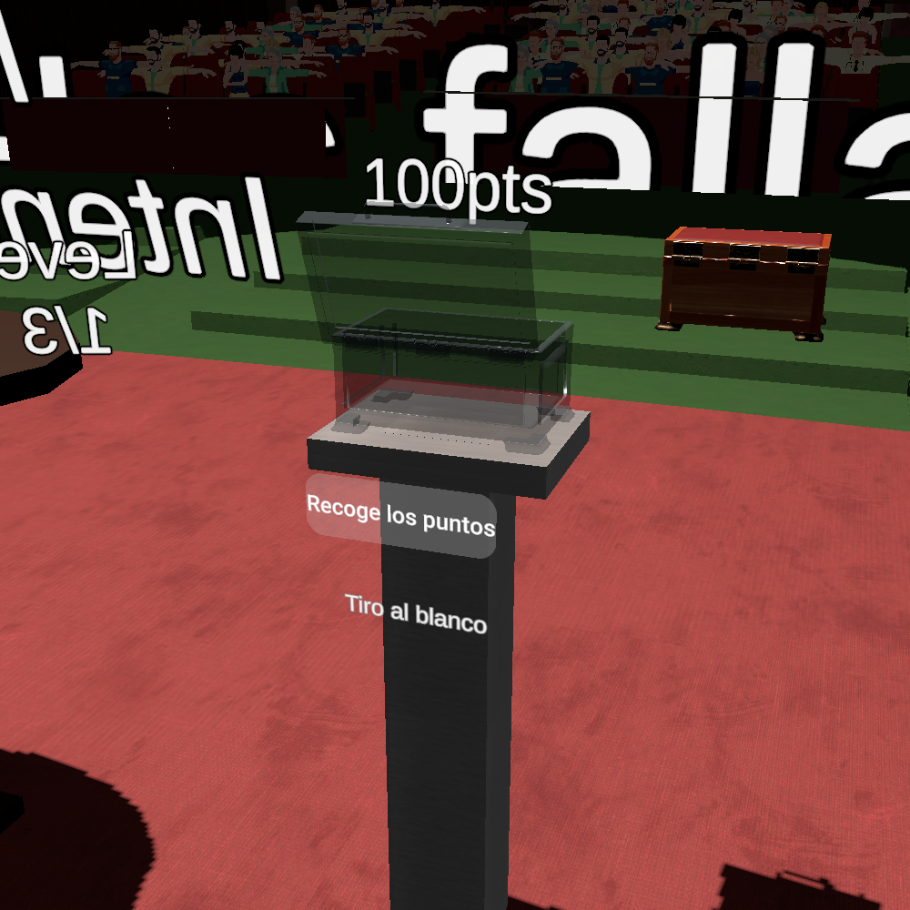

# Physical puzzle rewards

The AngerRoom scene now has one reward station per puzzle under **Puzzle Rewards**. The stations sit opposite the start controls, using the original glass Box and its pedestal as the placement reference. Shooting reuses that box and pedestal; Cards and Labyrinth use copies. The other, non-glass Box is unchanged.

## What the player experiences

1. The glass box contains a slowly rotating points label that moves slightly sideways and vertically. The opening button says **Locked**.
2. Each failed full attempt deducts 30 points, as before: **100 → 70 → 40 → 10**. The physical label updates immediately and retains the previous score colours.
3. Winning the puzzle, or failing the third attempt, unlocks its opening button. Finishing a tutorial or an intermediate level does not unlock it.
4. Pressing **Open** rotates the lid around its hinge. Once the lid is open, the points label rises above the box.
5. Bringing a tracked hand or Touch controller near the raised label starts collection. The text spins faster, rises slightly and shrinks away.
6. When the disappearance finishes, the scoreboard receives that puzzle's points. The button says **Collected**. The same reward cannot be collected again.

Completion and collection are now separate: a finished puzzle can have an uncollected reward. Existing completion audio and puzzle availability still follow puzzle completion. Rewards remain available after completion, including when the overall timer expires; the overall timer does not automatically collect them. Rewards are session state and reset when the scene restarts, as did the existing score state.

## Files and responsibilities

| File | Responsibility |
| --- | --- |
| `Assets/GamesManager.cs` | Owns attempts, available points, completion and whether each reward has been collected. Only this component asks ScoreboardManager to award puzzle points. |
| `Assets/Rewards/PuzzleRewardBox.cs` | Displays one puzzle's reward, enables its button, animates its lid and label, and requests collection. |
| `Assets/Rewards/RewardReachInput.cs` | Converts tracked hand/controller positions into world positions and checks distance to the reward. Shared by the three stations. |
| `Assets/Localization/TextId.cs`, `TextCatalog.cs`, `GameTexts.asset` | Define and translate the new labels using the existing TextAdapter. |

### How the objects communicate

The minigames still call `GamesManager.addTries(...)` and `GamesManager.GameWon(...)`. They do not need references to boxes, lids or animations.

After a score or completion change, GamesManager raises `RewardChanged(gameIndex)`. Each box subscribes to this event and refreshes only when the event concerns its puzzle. This is an ordinary C# event: GamesManager announces a change without needing to know which visual objects are listening.

The opening button calls its box's `OpenBox()`. The box checks `GamesManager.CanCollectReward(gameIndex)` before animating. At the end of collection it calls `TryCollectReward(gameIndex)`. A `Try...` method returns whether a request succeeded. GamesManager independently checks completion and prior collection, then marks the reward collected **before** calling ScoreboardManager. This protects the score even if another script accidentally asks for collection twice.

This division keeps gameplay rules in one place and presentation in another. Changing an animation later does not require changing the scoring rules. The box never subtracts points and never calls `AddPlayerPoints` directly.

### Why use a state machine?

`PuzzleRewardBox` has one state at a time:

`Locked → Ready → Opening → Rising → Available → Collecting → Collected`

Each state permits specific actions. `OpenBox()` accepts input only in Ready; reaching is checked only in Available. This prevents overlapping lid animations and collection through a closed box. Using an enum also prevents contradictory combinations such as `isLocked == true` and `isCollected == true`.

`Update()` advances the current animation using `Time.deltaTime`, so animation duration is measured in seconds rather than frames. Local positions preserve the layout when a complete station is moved or rotated. The script stores the initial position and adds a sine-wave offset each frame; it does not repeatedly add offsets to the previous position, which would cause drift.

The box subscribes after its references have been validated and unsubscribes when destroyed. Temporarily hiding a station pauses its animation; enabling it resumes the same state and refreshes its reward information.

### How reaching works

The shared RewardReachInput checks whether Meta reports a tracked left/right hand or left/right Touch controller. It transforms that tracked local position through the rig's **TrackingSpace**, then measures distance to the text's current world position. This follows the existing rig when it teleports; no teleport code was changed.

Collection uses proximity, not a grab or trigger press. The initial radius is **0.16 metres**, measured from the tracked hand/controller origin. It is not a fingertip collider. Adjust the radius during headset testing if touching the text feels too early or too late. Untracked poses do not collect a reward.

## Unity setup and tuning

The scene connections are already assigned. You do not need to add these scripts manually to the existing scene.

1. Open `Assets/Plugins/Scenes/AngerRoom.unity` and expand **Puzzle Rewards**.
2. Select **Cards Reward Pedestal**, **Shooting Reward Pedestal**, or **Labyrinth Reward Pedestal**. Each has a PuzzleRewardBox component with game index **0, 1, or 2**, respectively.
3. Move the entire pedestal parent to adjust placement. Its box, button, label and pedestal meshes move together. Keep the parent scale at `(1, 1, 1)` so metre-based animation settings remain intuitive.
4. In PuzzleRewardBox, adjust **Opening Duration**, **Rise Duration**, **Rise Height**, **Vertical Wobble**, **Horizontal Wobble**, **Wobble Frequency**, and **Idle Spin Speed**. Wobble Frequency is cycles per second; spin speeds are degrees per second. Horizontal motion uses 70% of the vertical frequency to avoid a simple diagonal oscillation.
5. Adjust **Reach Radius**, **Collect Duration**, and **Collect Spin Speed** for the collection feel. **Open Lid Euler** is the rotation offset from the lid's initial closed pose, applied around the existing hinge.
6. The **Open Reward Button** is a Meta poke button. Its PointableUnityEventWrapper Select event retains its button sound and calls the matching PuzzleRewardBox's `OpenBox()`. If replacing the button, reproduce that callback and assign its PokeInteractable and TMP text to the controller.
7. On **Puzzle Rewards**, RewardReachInput references the current OVRCameraRig's **TrackingSpace**. Reassign this if you replace the player rig.
8. Select the existing LanguageAdapter's language before Play Mode. Button labels and puzzle names use the same shared TextAdapter as the minigames. Edit translations in **GameTexts**, including RewardLocked, RewardOpen, RewardReach, RewardCollected and the three puzzle names. Changing TextCatalog's C# defaults alone does not edit the existing asset.

The glass boxes' original grab interactions are disabled: their lids are controlled by PuzzleRewardBox. Their original interaction colour visual is also disabled so it cannot override the glass material. The opening buttons keep their own interaction visuals. The previous three screen point labels are preserved but inactive; GamesManager's `scores` references now point to the three physical TMP labels. Dialogue objects were not changed.

## Headset checks

- Before playing, try pressing every reward button and reaching into each closed box. Nothing should award points.
- Fail a full attempt: only that puzzle's physical value changes to 70. Fail again: 40. Fail a third time: 10 and its box unlocks.
- In a fresh session, win a puzzle: its box unlocks, but the scoreboard remains unchanged until collection.
- Press the unlocked button, watch the lid and text, then reach with each hand/controller. Confirm the points arrive exactly as the text disappears.
- Keep a hand near the reward and press repeatedly: there must be no second award.
- Test reaching after teleporting, and repeat with the supported tracking modes and each language.

## Backups

Original modified files and their Unity metadata are preserved outside Assets in `Backups/PhysicalPuzzleRewards/2026-10-28`, with a SHA-256 manifest. Keeping old scripts outside Assets avoids duplicate compiled C# classes. To restore, close Unity and copy the matching original files back to their recorded paths. Restore the scene, GamesManager and localization files together so their references remain consistent.

## Verification performed

Unity 2022.3.45f1 imported and compiled the changes. The editor-only `PhysicalRewardValidation` utility passed **271 checks**, including real scene references and button callbacks, pedestal dimensions, translations, all four scoring outcomes for each puzzle, early/duplicate collection rejection, and the opening/rising/disappearance sequence. It drives animation time explicitly in Edit Mode; it does not simulate headset input or prove the tactile feel of the Meta button.

The utility runs only in a separate batch process with `-executeMethod PhysicalRewardValidation.Run`. It opens AngerRoom, exercises an unsaved in-memory scene, writes results and renders to `Temp/PhysicalRewardChecks`, and exits without saving. It is under an Editor folder and is excluded from game builds. The original-file backup checksums and Git whitespace checks also passed.

These Unity renders show the Shooting reward in the scene's selected Spanish language. The unrelated wooden box behind it is the original non-glass box, which was left unchanged.

