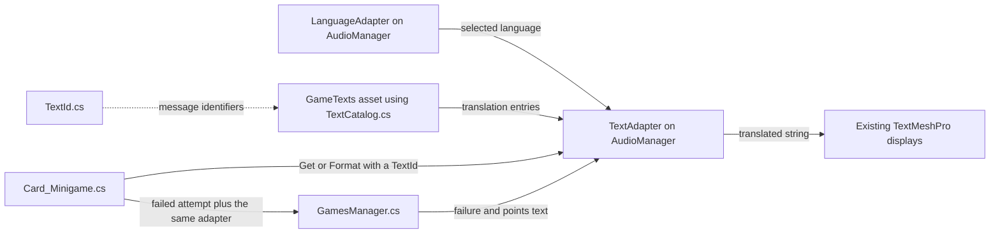

The card minigame now gets its player-facing messages from a shared text catalogue. Complete the Inspector setup below before playing. The selected language is read from the existing `LanguageAdapter` at the beginning of the session and stays fixed until the next session.

This first integration covers card tutorial labels, level and round progress, the next-level countdown, victory, failed attempts, the game-disabled message, and the score text updated after a failed card attempt. Dialogue objects retain their existing setup. Shooting, maze, and leaderboard text have not been migrated.

**Set up Unity once**

1. Exit Play Mode. Open `Assets/Plugins/Scenes/AngerRoom.unity` and wait for Unity to finish importing and compiling. The new scripts are already in `Assets/Localization`; do not copy the proposal scripts into Assets again.
2. In the Project window, select `Assets/Localization`. Right-click and choose **Create > Anger Room > Text Catalog**. Name the new asset **GameTexts**. This creates `Assets/Localization/GameTexts.asset`, with English, Italian, and Spanish examples already filled in. Review the wording in its **Entries** list.
3. In the Hierarchy, select the existing **AudioManager** GameObject. It already has the `AudioManager` and `LanguageAdapter` components. Click **Add Component**, search for **Text Adapter**, and add it. Only one shared `TextAdapter` is needed in this scene.
4. In the new **Text Adapter** component, assign **Language Adapter** by dragging the `LanguageAdapter` component header on that same object into the field. Assign **Catalog** by dragging the **GameTexts** asset from the Project window into it.
5. In the Hierarchy, select **Puzzle1 - Cards**. In its existing **Card_Minigame** component, find **References > Text Adapter**. Drag the **AudioManager** GameObject from the Hierarchy into that field. Unity picks its `TextAdapter` component because the field requires that type. Keep the existing card, audio, manager, and display references.
6. On **AudioManager > Language Adapter**, select **Current Language** before pressing Play. This is the same selection the audio already uses.
7. Save the scene and project. Press Play and start the card tutorial, then the card game. To try another language, stop Play Mode, change **Current Language**, and press Play again.

There are three new Inspector connections:

| Object and component | Field | Assign |
| --- | --- | --- |
| AudioManager / Text Adapter | Language Adapter | Existing LanguageAdapter on AudioManager |
| AudioManager / Text Adapter | Catalog | GameTexts asset |
| Puzzle1 - Cards / Card_Minigame | Text Adapter | TextAdapter on AudioManager |

The scene has not been edited for this localization integration. The steps above create the asset and scene references; no component needs to be added to a Dialogue object.

**Check it in Play Mode**

| Trigger | English example | What to check |
| --- | --- | --- |
| Card tutorial | Level / Round / Timer | All three labels use the selected language. |
| Start card game | Level then 1/3; Round then 1/3 | The line break and both numbers appear. |
| Finish a round | Round then 2/3 | The number changes while the language stays fixed. |
| Reach another level | Next level in... then 03 | Countdown digits retain two places. |
| Run out of time | You failed :( then Attempts remaining: 2 | The first failure leaves two attempts; the next leaves one. |
| Fail the third attempt | You failed! then Game disabled. | The disabled message persists as before. |
| Win the final round | You won! | The card victory message uses the selected language. |

Repeat for Italian and Spanish. The tutorial labels should be **Livello / Turno / Tempo** and **Nivel / Ronda / Reloj**, respectively. Check accents, line wrapping, and readability in the headset. Translations can be longer than the original wording, so adjust the relevant TextMeshPro display's layout if necessary. Audio still depends on the clips currently assigned for that language.

If the Console says to assign `LanguageAdapter` and `TextCatalog`, check step 4. If it reports an unassigned `Card_Minigame.textAdapter`, check step 5. A visible `[Missing: SomeId]` means the selected translation is absent or empty. `[Invalid format: SomeId]` means the template or supplied arguments are invalid; compare its placeholders with the contract in `TextId.cs`. A duplicate-ID error means two catalogue entries use the same Id.

**How the files connect**



`TextId.cs` defines stable names for messages, such as `Victory` and `RoundProgress`. The explicit enum numbers are serialized by Unity: keep existing numbers when adding new IDs. This avoids changes in enum order accidentally changing the meaning of saved catalogue entries.

`TextCatalog.cs` defines the shape of a translation asset. **GameTexts** is an instance of that shape, saved as project data. It holds the actual editable wording. Defaults in the C# file only populate newly created assets; editing those defaults does not update an existing asset.

`TextAdapter.cs` reads the selected language and builds a dictionary from message IDs to translations. It does this once, when its `Awake` runs or when it is first asked for text, whichever happens first. The lazy initialization avoids depending on whether the card or adapter runs first. It assumes `LanguageAdapter.currentLanguage` is already set, as it is when you configure it before Play Mode. If a future menu chooses the language at runtime, finish that selection before initializing this adapter.

`Card_Minigame.cs` supplies the message ID and gameplay values. It still decides when to update its displays. For example:

```csharp
roundText.text = textAdapter.Format(
    TextId.RoundProgress, currentRound, RoundsPerLevel);
```

With Spanish selected, the catalogue template is `Ronda\n{0}/{1}`. `Format` replaces `{0}` with `currentRound` and `{1}` with `RoundsPerLevel`, producing `Ronda` on one line and, for example, `2/3` on the next. Translators can move placeholders to suit a language without changing gameplay code. For a message with no changing values, use `Get`:

```csharp
timerText.text = textAdapter.Get(TextId.Victory);
```

`GamesManager.cs` already owns failed-attempt messages, so the card passes its adapter when reporting a failure:

```csharp
gamesManager.addTries(GameIndex, timerText, textAdapter);
```

This is a method overload: the same method name has a version with two arguments and a version with three. Existing minigames still call the two-argument version. It delegates to the three-argument version with `null`, which preserves their existing Spanish messages. The shared attempt-counting and score calculation remain in one method. Migrating another game later means passing the same adapter, without duplicating that logic.

The new reference fields use `[SerializeField] private`: Unity can save and display them, while other scripts cannot freely replace them. The shared adapter is an explicit dependency assigned in the Inspector, so the card does not search the scene or rely on a global singleton. Separating translation data, lookup, and gameplay makes each easier to maintain independently. The existing `addTries` name is kept for compatibility; new C# public methods normally use PascalCase, as `Get` and `Format` do.

**Change or add text later**

For an existing card message, exit Play Mode, select **GameTexts**, find its **Id** under **Entries**, and edit the language fields. Keep placeholders intact: `{0}`, `{1}`, and `{0:00}` have specific meanings. Enter actual line breaks in the Inspector's multiline fields; typing the characters `\n` there does not create a line break. Save and restart Play Mode to load the edited translations.

For a new message, follow these steps:

1. Add a descriptive name with an unused numeric value to `Assets/Localization/TextId.cs`. Keep all existing values. Add a comment describing any placeholders.
2. Wait for compilation. In **GameTexts > Entries**, add an element and select the new **Id**. Unity can duplicate the last list element when expanding the list, so assign the new Id explicitly.
3. Fill in all three translations. Keep their placeholder indexes consistent.
4. In the script that updates the display, use `textAdapter.Get(TextId.YourId)` for fixed wording or `textAdapter.Format(TextId.YourId, values...)` for variable content. A script that has not yet been integrated needs a serialized adapter reference and its Inspector assignment first.
5. Save, start a fresh Play session, trigger the message, and check each language.

Adding an entry to GameTexts supplies wording; it does not automatically decide where or when to show it. The card script currently requests only its known IDs. The optional static room-label component remains a proposal in `Proposals/TextLocalization/Examples/RoomTextUsageExample.cs`; it has not been added to any room or Dialogue object.

**Preserved copies and validation**

The exact pre-integration `Card_Minigame.cs` and `GamesManager.cs`, including their `.meta` files, are in `Backups/CardTextLocalization/2026-10-22`. Their hashes are recorded in `manifest.json`. Backup and proposal scripts stay outside Assets so Unity does not compile duplicate classes. `Assets/CubesPuzzle.cs` also remains preserved from the earlier replacement.

The updated Assembly-CSharp sources compiled against the installed Unity 2022.3.45f1 libraries with zero errors. An isolated harness ran 90 assertions covering all three languages, tutorial/progress/transition/victory displays, the card-to-manager failure path, attempt and score values, the session language lock, and the existing two-argument manager call. The harness substitutes engine and audio objects; it does not validate actual Unity serialization, coroutine timing, font coverage, or headset layout. Complete the Inspector wiring and Play Mode checks above to verify those. Backup hashes were checked, and the scene file is unchanged from the beginning of this integration.

To roll back this step, stop Play Mode and restore both backed-up scripts to their original paths, retaining their matching `.meta` files. If you completed the Inspector setup, remove the newly added TextAdapter component; the translation scripts and asset can remain unused. Do not copy the entire backup folder into Assets.
