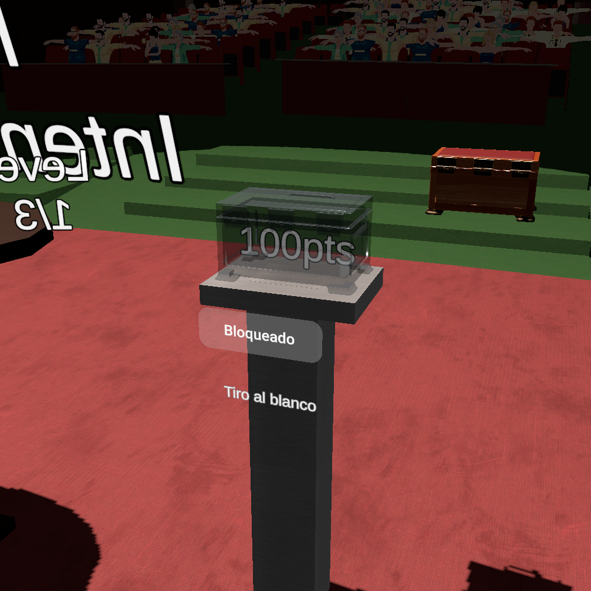

# Physical puzzle rewards

The AngerRoom scene now has one reward station per puzzle under **Minigame Rewards**. The stations sit opposite the start controls, using the original glass Box and its pedestal as the placement reference. Shooting reuses that box and pedestal; Cards and Labyrinth use copies. The other, non-glass Box is unchanged.

## What the player experiences

1. The glass box contains a slowly rotating points label that moves slightly sideways and vertically. The opening button shows the **locked padlock icon** on a translucent red background.
2. Each failed full attempt deducts 30 points, as before: **100 → 70 → 40 → 10**. The physical label updates immediately and retains the previous score colours.
3. Winning the puzzle, or failing the third attempt, unlocks its opening button: the icon changes to **unlocked** and the background turns green. Finishing a tutorial or an intermediate level does not unlock it.
4. Physically pressing the button rotates the lid around its hinge. Pointing a ray at it does not activate it. Once the lid is open, the points label rises above the box.
5. Bringing a tracked hand or Touch controller near the raised label starts collection. The text spins faster, rises slightly and shrinks away.
6. When the disappearance finishes, the scoreboard receives that puzzle's points. The button keeps the green/unlocked indication. Further presses cannot reopen the box or collect its reward again.

Completion and collection are now separate: a finished puzzle can have an uncollected reward. Existing completion audio and puzzle availability still follow puzzle completion. Rewards remain available after completion, including when the overall timer expires; the overall timer does not automatically collect them. Rewards are session state and reset when the scene restarts, as did the existing score state.

## Files and responsibilities

| File | Responsibility |
| --- | --- |
| `Assets/GamesManager.cs` | Owns attempts, available points, completion and whether each reward has been collected. Only this component asks ScoreboardManager to award puzzle points. |
| `Assets/Rewards/MinigameRewardBox.cs` | Displays one puzzle's reward, enables its button, animates its lid and label, and requests collection. |
| `Assets/Rewards/RewardReachInput.cs` | Converts tracked hand/controller positions into world positions and checks distance to the reward. Shared by the three stations. |
| `Assets/Localization/TextId.cs`, `TextCatalog.cs`, `GameTexts.asset` | Translate the points format and optional minigame-name labels. Buttons use PNG icons and need no translation. |

### How the objects communicate

The minigames still call `GamesManager.addTries(...)` and `GamesManager.GameWon(...)`. They do not need references to boxes, lids or animations.

After a score or completion change, GamesManager raises `RewardChanged(gameIndex)`. Each box subscribes to this event and refreshes only when the event concerns its puzzle. This is an ordinary C# event: GamesManager announces a change without needing to know which visual objects are listening.

The opening button calls its box's `OpenBox()`. The box checks `GamesManager.CanCollectReward(gameIndex)` before animating. At the end of collection it calls `TryCollectReward(gameIndex)`. A `Try...` method returns whether a request succeeded. GamesManager independently checks completion and prior collection, then marks the reward collected **before** calling ScoreboardManager. This protects the score even if another script accidentally asks for collection twice.

This division keeps gameplay rules in one place and presentation in another. Changing an animation later does not require changing the scoring rules. The box never subtracts points and never calls `AddPlayerPoints` directly.

### Why use a state machine?

`MinigameRewardBox` has one state at a time:

`Locked → Ready → Opening → Rising → Available → Collecting → Collected`

Each state permits specific actions. `OpenBox()` accepts input only in Ready; reaching is checked only in Available. This prevents overlapping lid animations and collection through a closed box. Using an enum also prevents contradictory combinations such as `isLocked == true` and `isCollected == true`.

`Update()` advances the current animation using `Time.deltaTime`, so animation duration is measured in seconds rather than frames. Local positions preserve the layout when a complete station is moved or rotated. The script stores the initial position and adds a sine-wave offset each frame; it does not repeatedly add offsets to the previous position, which would cause drift.

The box subscribes after its references have been validated and unsubscribes when destroyed. Temporarily hiding a station pauses its animation; enabling it resumes the same state and refreshes its reward information.

### How reaching works

The shared RewardReachInput checks whether Meta reports a tracked left/right hand or left/right Touch controller. It transforms that tracked local position through the rig's **TrackingSpace**, then measures distance to the text's current world position. This follows the existing rig when it teleports; no teleport code was changed.

Collection uses proximity, not a grab or trigger press. The initial radius is **0.16 metres**, measured from the tracked hand/controller origin. It is not a fingertip collider. Adjust the radius during headset testing if touching the text feels too early or too late. Untracked poses do not collect a reward.

## Unity setup and tuning

The scene connections are already assigned. You do not need to add these scripts manually to the existing scene.

1. Open `Assets/Plugins/Scenes/AngerRoom.unity` and expand **Minigame Rewards**.
2. Select **Cards Reward Pedestal**, **Shooting Reward Pedestal**, or **Labyrinth Reward Pedestal**. Each has a MinigameRewardBox component with game index **0, 1, or 2**, respectively.
3. Move the entire pedestal parent to adjust placement. Its box, button, label and pedestal meshes move together. Keep the parent scale at `(1, 1, 1)` so metre-based animation settings remain intuitive.
4. In MinigameRewardBox, adjust **Opening Duration**, **Rise Duration**, **Rise Height**, **Vertical Wobble**, **Horizontal Wobble**, **Wobble Frequency**, and **Rotation Amplitude** and **Rotation Frequency**. Wobble Frequency is cycles per second; spin speeds are degrees per second. Horizontal motion uses 70% of the vertical frequency to avoid a simple diagonal oscillation.
5. Adjust **Reach Radius**, **Collect Duration**, and **Collect Spin Speed** for the collection feel. **Open Lid Euler** is the rotation offset from the lid's initial closed pose, applied around the existing hinge.
6. The **Open Reward Button** is a Meta poke button. Its PointableUnityEventWrapper Select event retains its button sound and calls the matching MinigameRewardBox's `OpenBox()`. Despite the name *Pointable*, this wrapper forwards the assigned PokeInteractable's events; it does not add ray interaction. If replacing the button, reproduce that callback and assign its PokeInteractable, icon SpriteRenderer and two sprites to MinigameRewardBox. Do not add a RayInteractable or a UI Button to the reward button.
7. On **Minigame Rewards**, RewardReachInput references the current OVRCameraRig's **TrackingSpace**. Reassign this if you replace the player rig.
8. Select the existing LanguageAdapter's language before Play Mode. Points and optional puzzle names use the same shared TextAdapter as the minigames. The four former button translations have been removed from TextId, TextCatalog and GameTexts. IDs 64–66 for puzzle names remain unchanged. Changing TextCatalog's C# defaults alone does not edit the existing asset.
9. The **Minigame Label** reference is optional, so removing a pedestal's name label does not disable its reward script.

### Button icons and colour states

The icon is a SpriteRenderer named **Lock Icon**, attached to the moving button face so it moves with a physical press. It uses the supplied `locked-icons8-bloquear-50.png` and `unlocked-icons8-desbloquear-50.png` assets in `Assets/PNGs`. There is no Canvas, UI Button, collider or ray interaction on the icon itself.

The existing **InteractableColorVisual** on the rounded button face observes the button's PokeInteractable. Expand the button hierarchy to find this component and tune its four colour states:

| SDK state | Appearance | Meaning |
| --- | --- | --- |
| Disabled | Red, alpha 0.40 | Puzzle has not finished; poke component is disabled. |
| Normal | Green, alpha 0.40 | Puzzle has finished; physical button is enabled. |
| Hover | Brighter green, alpha 0.55 | A nearby poke interactor approaches the button. |
| Select | Brighter green, alpha 0.70 | Physical press. |

This button's RoundedBox shader uses **`_Color`**. That differs from a URP Lit material's `_BaseColor`: the property must match the material actually being coloured. MaterialPropertyBlockEditor applies the colour to this button's renderer without changing the shared material of other buttons. RoundedBoxProperties also has an initial red colour for the scene preview; InteractableColorVisual drives gameplay colour transitions.

The poke component stays enabled after opening so the visual continues to represent an unlocked box. The `Ready` state check in `OpenBox()` rejects further presses. This separates **puzzle completion** (the icon and hue) from **whether an opening action remains available** (the box's state). Repeat presses may still give the button's normal visual/audio feedback, but do not restart the animation or affect points.

The glass boxes' original grab interactions are disabled: their lids are controlled by MinigameRewardBox. Their original interaction colour visual is also disabled so it cannot override the glass material. The opening buttons use their own InteractableColorVisual. The previous three screen point labels are preserved but inactive; GamesManager's `scores` references now point to the three physical TMP labels. Dialogue objects were not changed.

## Headset checks

- Before playing, try pressing every reward button and reaching into each closed box. Nothing should award points.
- Check that each button starts red with a locked icon. Try pointing and pressing the remote trigger: it must not open a box.
- Fail a full attempt: only that puzzle's physical value changes to 70. Fail again: 40. Fail a third time: 10 and its box unlocks.
- In a fresh session, win a puzzle: its box unlocks, but the scoreboard remains unchanged until collection.
- Confirm the unlocked icon and green hue appear only for that puzzle, including when the third attempt is exhausted.
- Press the unlocked button, watch the lid and text, then reach with each hand/controller. Confirm the points arrive exactly as the text disappears.
- Keep a hand near the reward and press repeatedly: there must be no second award.
- Test reaching after teleporting, and repeat with the supported tracking modes and each language.

## Backups

Original modified files and their Unity metadata are preserved outside Assets in `Backups/PhysicalPuzzleRewards/2026-10-28`, with a SHA-256 manifest. Keeping old scripts outside Assets avoids duplicate compiled C# classes. To restore, close Unity and copy the matching original files back to their recorded paths. Restore the scene, GamesManager and localization files together so their references remain consistent.

The subsequent icon/button update has a separate backup at `Backups/PhysicalPuzzleRewards/2026-10-28-IconButtons`, including the scene as edited by you immediately before this update.

## Verification performed

Unity 2022.3.45f1 imported and compiled the changes. The editor-only `PhysicalRewardValidation` utility passed **302 checks**, including real scene references and button callbacks, pedestal dimensions, translations, all four scoring outcomes for each puzzle, early/duplicate collection rejection, and the opening/rising/disappearance sequence. It drives animation time explicitly in Edit Mode; it does not simulate headset input or prove the tactile feel of the Meta button.

The utility runs only in a separate batch process with `-executeMethod PhysicalRewardValidation.Run`. It opens AngerRoom, exercises an unsaved in-memory scene, writes results and renders to `Logs/PhysicalRewardChecks`, and exits without saving. It is under an Editor folder and is excluded from game builds. The original-file backup checksums and Git whitespace checks also passed.

These Unity renders show the Shooting reward with the supplied lock icons and the updated button colours, retaining your latest pedestal placement.

### Minigame reward rotation

Idle rotation now swings around the initial Y orientation using a sine wave. Rotation Amplitude defaults to 30 degrees (limits of -30 and +30); Rotation Frequency defaults to 0.25 cycles per second (one full cycle every four seconds). Floating movement is unchanged. Collection starts its full spin at the current swing angle, then accelerates towards Collect Spin Speed as the text disappears.

### Points colour and collection sounds (2026-10-30)

MinigameRewardBox now owns the points text colour. GamesManager supplies the remaining attempts; it no longer writes a competing fixed colour after a failure. The four Inspector colours correspond to 3 attempts (green), 2 (yellow), 1 (red), and 0 (dark grey). All are fully opaque by default.

The colour uses the same clock and Wobble Frequency as vertical movement. `(1 - cos(phase)) / 2` produces a smooth 0-to-1-to-0 blend: white at the start, the attempt colour halfway through, then white again. `Color.Lerp` applies that blend each frame. Setting Wobble Frequency to zero also stops the colour pulse at white. Rotation Frequency still controls the separate left/right swing.

On each reward pedestal, expand **Collection audio (optional)** on MinigameRewardBox:

- **Reward Collection Clip**: sound for collecting 100, 70, or 40 points.
- **Minimum Reward Collection Clip**: sound for collecting 10 points.
- **Collection Volume**: playback gain, initially 0.5.

Drag audio assets into these slots when available. Empty slots are valid and silent. The clip plays only after the disappearance animation successfully awards the points, rather than every time a tracked hand enters the reach radius. PlayClipAtPoint creates a temporary 3D source at the text position, so hiding the points does not cut the sound off. This temporary source uses Unity's default audio routing; it is not connected to a custom mixer group.

### Overall timeout settlement (2026-10-30)

When the overall experiment timer ends, each unfinished minigame becomes worth 10 points. GamesManager awards these immediately through TryCollectReward, whose duplicate guard remains shared with physical collection. RewardChanged makes the matching box deactivate its points GameObject. The box and pedestal remain present; automatic settlement does not play a grab sound.

Completed minigames and those already exhausted after three failures retain their rewards and existing collection status. In particular, a completed but uncollected reward stays available at its earned value. The timeout does not invent additional logged attempts: experimentExpired marks the session ended and prevents late win/failure callbacks from altering the settled values. All remaining start controls are disabled and blacklisted immediately.

Original scripts for this change are preserved outside Assets in `Backups/RewardFeedback/2026-10-30`. Headset testing should check colour readability, the sound position once clips are assigned, and timeout during an unfinished minigame.

Unity batch validation passed 342 checks after this update, including the four colour cycles, optional clip selection, all unfinished timeout values, preservation of completed rewards, hidden timeout points objects, and duplicate/late callback protection. No scene was saved by the validation utility.
