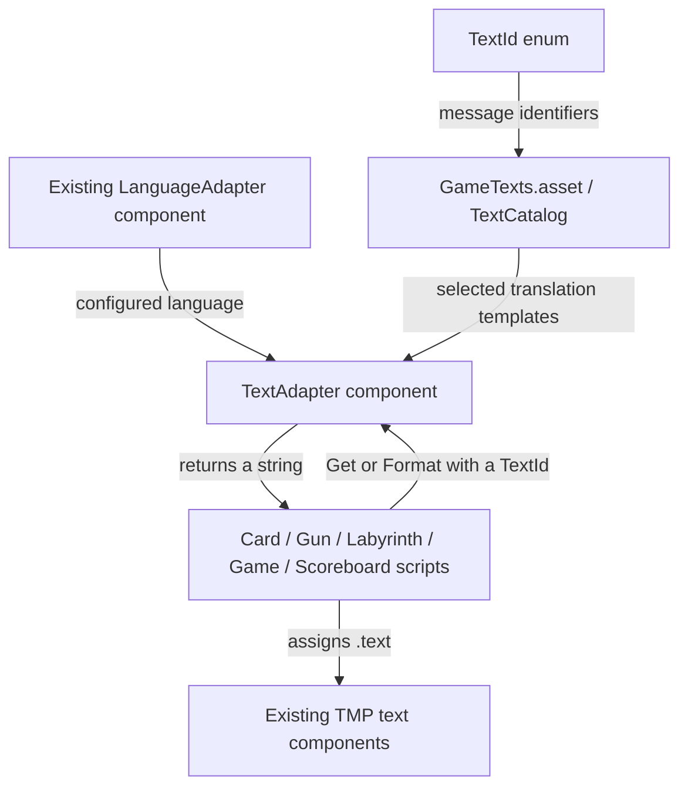

This is a reviewable proposal for text written by gameplay scripts. Its files are outside `Assets`, so Unity does not import them into the game. The existing scripts, scene, audio handling, and Dialogue objects have not been edited for this proposal. There is deliberately no `LocalizedText` component for scene objects.

Read the files in this order: `TextId.cs`, `TextCatalog.cs`, `TextAdapter.cs`, then `Examples/CardTextUsageExample.cs`.

| File | Kind of C# type | What it provides | Where it would live in Unity |
| --- | --- | --- | --- |
| `TextId.cs` | Enum | Stable names for messages, such as `Victory` and `LevelProgress` | Used by code; no component or asset to attach |
| `TextCatalog.cs` | ScriptableObject | Translation entries for English, Italian, and Spanish | A `GameTexts.asset` created through the Assets menu |
| `TextAdapter.cs` | MonoBehaviour | A session language snapshot, text lookup, and formatting | One shared component on an active manager GameObject |
| `CardTextUsageExample.cs` | Example MonoBehaviour | The calls a minigame would make | Read as a usage example; later incorporate those calls into the actual minigame |

The files are connected by C# types and Inspector references. File names alone do not connect anything. The `AngerRoom.Localization` namespace groups the proposed types; `using AngerRoom.Localization;` lets an existing script refer to them by their short names.



For example, a future call from `Card_Minigame` would be:

```csharp
levelText.text = textAdapter.Format(TextId.LevelProgress, currentLevel, LevelCount);
```

If Spanish is selected and the values are `2` and `3`, the path is:

1. `TextId.LevelProgress` identifies a message. It contains no Spanish or English wording.
2. The catalogue entry contains `Level\n{0}/{1}`, `Livello\n{0}/{1}`, and `Nivel\n{0}/{1}`.
3. On initialization, `TextAdapter` reads the configured `LanguageAdapter.currentLanguage` and builds a dictionary containing the Spanish entries.
4. `Format` looks up `Nivel\n{0}/{1}`, substitutes `2` and `3`, and returns `Nivel\n2/3`.
5. The minigame assigns that returned string to its existing text component. The adapter does not know about cards, levels, or that component.

The example file makes the last step visible without changing the actual minigame. It contains no playable game loop.

The future Inspector wiring would be:

```text
Existing language/audio manager GameObject
  LanguageAdapter
    Current Language: Spanish
  TextAdapter
    Language Adapter: [drag the existing LanguageAdapter here]
    Catalog:          [drag GameTexts.asset here]

Card minigame GameObject
  Card_Minigame
    Text Adapter:     [drag the shared TextAdapter here]
    Level Text:       [existing reference]
    Round Text:       [existing reference]
    Timer Text:       [existing reference]
```

After approval, `TextCatalog.cs` would provide an **Assets > Create > Anger Room > Text Catalog** menu item. Creating a catalogue produces a `GameTexts.asset` data file. A ScriptableObject is an asset reference, not a component to add to a GameObject. All minigames can share the same adapter and catalogue.

The sample translations are prefilled in the source so you can read a complete example now. They are drafts for review. In an integrated project, editing the catalogue asset in the Inspector would be the usual workflow. Source defaults seed newly created assets; they do not overwrite an existing asset's saved entries.

The startup contract is that the language is configured **before entering Play Mode**. `TextAdapter` initializes in `Awake`, or on its first request if another script calls it earlier. `EnsureInitialized()` only builds the dictionary once, so consumers do not depend on the order of different `Start()` methods. Both wording and numeric culture remain fixed for that component's session, even if its Inspector language field is subsequently changed.

This version uses the existing `LanguageAdapter` API unchanged. Audio already selects its lists in `AudioManager.Start()`. With the language configured before startup, both select the same language. A future runtime language-selection screen would require an explicit initialization step after selection and before either consumer initializes; this proposal does not add that screen.

`Get` returns a plain message or an unformatted template. `Format` adds substitution through `string.Format`, using a culture matching the selected language. The `params object[]` parameter accepts a variable number of values: in `Format(id, 2, 3)`, `{0}` receives `2` and `{1}` receives `3`. Translators can reorder those placeholders. `{0:00}` formats an integer with at least two digits, and `\n` creates a line break.

The enum comments document each message's argument contract. For example, `LabyrinthStatus` expects level, minutes, and seconds in that order. `ScoreboardEntry` expects participant ID, points, and rank. The adapter does not calculate those values or change score rules.

Explicit enum numbers preserve Inspector selections as IDs are reorganized. Adding an ID requires a catalogue entry, but changing wording requires no gameplay-code change. The dictionary gives direct lookup by ID; there is no fragile agreement that “item 7” in several separate lists must mean the same message.

The proposal also makes configuration mistakes visible. Duplicate or invalid IDs and missing adapter references produce clear initialization errors. Missing selected-language translations produce a visible `[Missing: ID]` marker and one warning per ID. Malformed format strings or insufficient arguments produce `[Invalid format: ID]`. Extra arguments and incorrect argument meaning are not detectable by `string.Format`; the documented contracts and verification examples are still important. No language is silently substituted for missing content.

There is no per-frame language detection. Gameplay code can format a value when it changes. For countdown labels, refreshing when the displayed second changes is sufficient; `params object[]` can allocate and box numbers, so it is unnecessary to call it every frame. Plain `mm:ss` clocks and clearing a label with `string.Empty` can keep their existing code.

The sample entries cover the wording currently written by the main card, shooting, labyrinth, general game, and scoreboard scripts. Dialogue objects are excluded. The separate `Assets/Shooter/GameManager.cs` also contains English labels; during integration we should confirm whether that alternative shooter is used before adding its separate messages.

The proposed integration order is: preserve the existing source versions, import the three core files, create and inspect the catalogue asset, assign the two adapter references, then replace a few card-minigame text assignments first. Once that is checked in Unity for all three languages, migrate the other active consumers. Copies with identical C# class names should be retained outside `Assets` so Unity does not compile duplicate classes. The example file can remain here as a reference.
