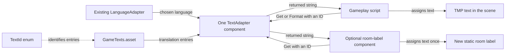

These are proposed files for review. They live outside Unity's `Assets` folder, so they do not run in the game. No gameplay scripts or scene objects have been connected to this system. Dialogue objects remain manually maintained as separate language versions.

Start with the file map below, then read the [technical explanation](README.md). For a teammate who needs to add or edit text, use the [step-by-step contributor guide](ADDING_TEXT.md). The optional room-label example extends the original script-focused draft; it is a demonstration for a new label, not a migration of existing Dialogue objects.

| Read in this order | File | What it is | What you would do with it |
| --- | --- | --- | --- |
| 1 | [TextId.cs](TextId.cs) | An enum: stable identifiers for the messages | Add a name when introducing a new meaning, such as `RoomWelcome` |
| 2 | [TextCatalog.cs](TextCatalog.cs) | A ScriptableObject class: the structure and sample content of the catalogue | Create a `GameTexts.asset` in Unity, then edit its translation entries in the Inspector |
| 3 | [TextAdapter.cs](TextAdapter.cs) | A MonoBehaviour: selects the language once, looks up text, formats values | Add one component to an active manager and assign its two references |
| 4 | [CardTextUsageExample.cs](Examples/CardTextUsageExample.cs) | An example consumer for text that changes during a game | See the calls we would later incorporate into the real minigame |
| Optional | [RoomTextUsageExample.cs](Examples/RoomTextUsageExample.cs) | An example consumer for a static label placed in the room | Attach it to a new label after integration, and choose a text ID in the Inspector |

The `GameTexts.asset` file does not exist yet. It would be created from the `TextCatalog` class during integration. The C# class defines the fields and initial sample translations; the asset stores the translations you edit and save in Unity.

The namespace `AngerRoom.Localization` organizes the C# types. A `using AngerRoom.Localization;` statement lets another script use those types by their short names. It does not locate a component, create an asset, or assign a reference. Those connections are explicit Inspector assignments.



For example, suppose the selected language is Spanish and the card game is at level 2 of 3:

```csharp
levelText.text = textAdapter.Format(TextId.LevelProgress, 2, 3);
```

1. `levelText` is the reference to the existing text component that displays the result.
2. `textAdapter` is a reference to the shared adapter component, assigned in the Inspector.
3. `TextId.LevelProgress` identifies an entry; it is not the text itself.
4. The adapter retrieves the session's Spanish template: `Nivel\n{0}/{1}`.
5. `Format` replaces `{0}` with `2` and `{1}` with `3`.
6. The returned string is assigned to the text component. On screen it reads `Nivel`, followed by `2/3` on the next line.

These components would be wired as follows:

```text
Existing language/audio manager (active at startup)
  LanguageAdapter
    Current Language: Spanish
  TextAdapter
    Language Adapter: [existing LanguageAdapter component]
    Catalog:          [GameTexts.asset from the Project window]

Card minigame
  Card_Minigame (when integrated)
    Text Adapter: [shared TextAdapter component]
    Level Text:   [existing level text component]

Optional new room label
  TextMeshPro or TextMeshProUGUI
  RoomTextUsageExample
    Text Adapter: [the same shared TextAdapter component]
    Target:       [this label's text component]
    Text Id:      [an entry such as LevelLabel, or a new RoomWelcome ID]
```

There is one language selection, one shared adapter, and one shared catalogue. Each label or minigame retains its own text-component references. The adapter returns strings and does not search the scene or activate objects.

The proposal uses the existing `LanguageAdapter.currentLanguage` API. Configure it before entering Play Mode. `TextAdapter` captures that setting during initialization; audio already selects its lists in `AudioManager.Start()`. `Get` and `Format` can initialize the adapter on their first call, so consumers do not depend on another component's `Start()` order. After that, the language and templates are cached for the session.

The two consumer examples have different lifetimes. The card example formats values when a gameplay event supplies them. The room-label example sets a static message once in `Start()`, including when an initially inactive object is first activated. Only one component should control a given text field. Do not add the static label example to a timer, scoreboard, or other field already controlled by gameplay.

The next integration step would be to preserve source copies, import the core files, create the catalogue asset, assign the shared references, and replace a small set of card-text assignments first. Existing Dialogue objects are outside this plan. Original versions will be kept; archival copies with duplicate class names belong outside `Assets` so Unity does not compile them.

The contributor guide distinguishes three jobs: editing wording in an existing entry, creating a genuinely new message, and displaying it in a room label or gameplay script. Updating wording needs no C# edit. A new message ID needs one small enum addition; a teammate who does not edit code can ask the maintainer to register it, then handle the translations and label placement in Unity.
